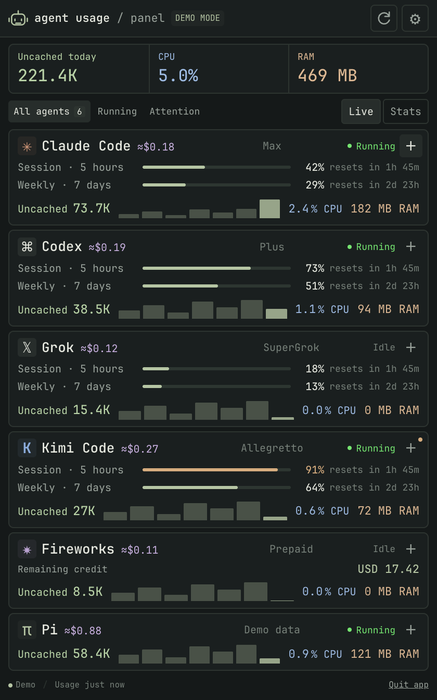
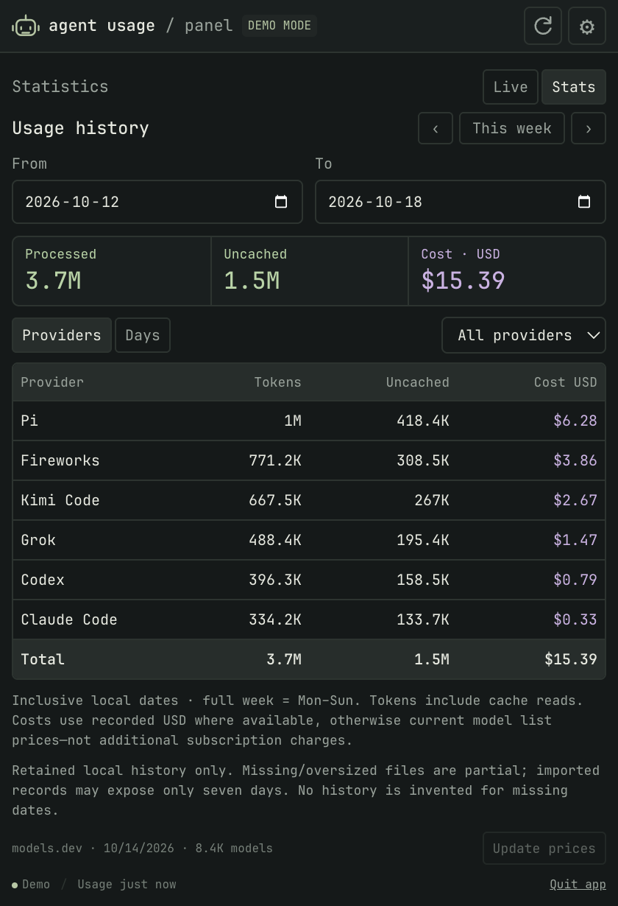
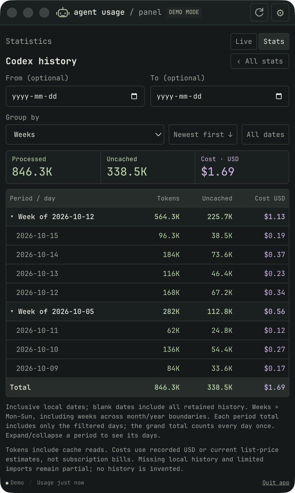

# Agent Usage Panel

**Your limits, tokens, and resources. In one quiet place.**

A private desktop menu-bar / system-tray monitor for AI coding agents, inspired
by Omarchy's agent panel. Native desktop integration on macOS, Windows, and
supported Linux desktops; no Hyprland, Quickshell, Bash, Python, or `jq` required.



## Run it

Requires **Node.js 22.12+** and npm on a supported desktop OS.

```sh
npm ci
npm start
```

Or explore without reading credentials, histories, or processes:

```sh
npm run demo
```

The compact **420px-wide** window fits its height to the content, eliminating
unused space below the footer. It grows/shrinks with filters, details, and views,
up to the display's usable height; longer content scrolls. Maximized/fullscreen
windows are left alone. Thin full-width rows use larger **JetBrains Mono** text,
wide activity charts, and consistent token/CPU/RAM colors. Empty quota/status
rows are folded into the centered heading. Refresh is an icon beside Settings;
details expand with **+**, and today's cost appears next to each provider name.
On macOS, the original native traffic-light controls are integrated into this
same header—there is no separate OS title bar. Drag the header's empty areas to
move the window; controls and header buttons remain clickable. Closing still
hides to the menu bar. Windows/Linux keep their native frame and controls.

Providers always sort **most active first**: running agents, then today's
processed tokens descending, then latest observed request/prompt, then recent
seven-day volume. Complete ties use name/ID for a stable order. CPU/RAM samples
never shuffle equal-usage rows. Filters retain this order; new usage and process
starts/stops update it automatically. Undated imports are not treated as newly
used just because their file was refreshed. Stats provider totals (and providers
within each day) sort by selected-range/day token usage descending.

The panel opens immediately, with a robot icon in the menu bar / system tray.
On **macOS it is menu-bar-only**, with no running Dock icon (including while the
panel or Settings is open). If a menu-bar item cannot be created, the Dock icon
returns so the app remains accessible. A previously pinned Dock shortcut is
independent: right-click it → Options → Remove from Dock if needed.
Left-click the menu-bar icon to show or hide only the panel; right-click for Open, Refresh,
and Quit. On macOS, left-click never opens the context menu.
macOS also shows the highest current quota percentage beside the icon. Closing
the window keeps monitoring; **Quit app** actually exits. `R` refreshes,
`Esc` hides the panel, and `Ctrl/Cmd+,` opens settings.

**The installed app starts automatically when you log in after boot.** It uses
macOS native Login Items, Windows startup registration, or an XDG autostart entry
on Linux. Login launches stay in the tray/menu bar (unless a tray is unavailable).
Settings → **Launch at login** turns this off. Existing settings are migrated
without resetting your preferences. Demo/development/test sessions never change
OS startup settings. OS policy/permissions can block startup; failures appear in
the panel. Keep Linux AppImages at a stable path; launch the app after moving one
to update its registration. This is desktop login startup, not a system service
running before anybody signs in.

**Network quota checks are off initially.** Open Settings to enable them. Local
history and CPU/RAM monitoring are on and can be independently disabled.

## What it tracks

| Provider | Subscription / credit information | Local token history | CPU / RAM |
| --- | --- | --- | --- |
| Claude Code | OAuth 5-hour, weekly, and model-specific windows | `projects/**/*.jsonl` | CLI and descendants |
| Codex | CLI app-server rate-limit windows and plan | Native OpenAI rollouts + Pi `openai-codex` requests | CLI and descendants |
| Grok | Included weekly/monthly credit percentage | `sessions/**/usage.json` | CLI and descendants |
| Kimi Code | Current and legacy quota response formats | Not collected | CLI and descendants |
| Fireworks | Live balance when the key has billing permission | Import Omarchy billing statistics | Not separately attributable |
| Pi (harness) | Multi-provider; Codex subscription usage belongs to Codex | Other Pi providers remain here | Pi CLI and descendants |
| Other agents | Import a display-ready Omarchy record | From that record | No automatic detection |

Each card has quota meters, reset countdowns, token counts, seven-day activity,
CPU/RAM, and expandable model statistics. A configurable threshold (90% by
default) marks high usage and sends an OS notification once per crossing/window.
Stale quota is dimmed and **does not trigger alerts**. Notification delivery
requires OS permission. Prepaid balances are displayed, not used for alerts.

### Understanding the token counts

- **Uncached today** is input + output minus cached input reads. Cache creation
  remains uncached input. This is the main figure when a breakdown is available.
- **Processed today** includes cached reads once per request. A long conversation
  can reuse its context many times, making this much larger than uncached tokens.
  Expand **+** for uncached/cached/processed figures and today's source breakdown;
  hover the summary for the same distinction. Charts/models remain cache-inclusive.
- Pi messages explicitly marked `openai-codex` are grouped under **Codex**, not
  added again to Pi. Pi's CPU/RAM remain harness metrics, with a pointer to Codex;
  other Pi backends (including ordinary OpenAI API usage) remain separate.
- Copied Pi transcripts/partial messages are deduplicated using stable response
  IDs, or entry IDs plus timestamp. Explicit shared response IDs deduplicate
  across native/Pi logs. Different requests are **not** discarded just because
  they use the same model, subscription, or token counts. Native rollout formats
  without shared request IDs cannot prove cross-log overlap.
- Imported aggregates and old total-only records may not expose cached reads.
  Their breakdown is **unknown**, not zero; the summary then honestly switches to
  **Processed today**. An imported Codex record replaces native Codex **and**
  Pi/OpenAI Codex totals, with a warning that its Pi coverage cannot be verified.

These are retained local-history estimates, **not subscription quota, unique
words, billed spend, or an account-level ledger**. Provider quota percentages
come from separate opt-in checks. Using the same subscription does not itself
mean two logged requests are duplicates.

### Stats and model costs

Switch **Live → Stats** for **Providers** and **Days** tabs. The default range is
the complete current **Monday–Sunday** week. **‹ / ›** shift both selected dates
by seven calendar days; **Today** sets both dates to the current local day and
**This week** resets them. Choose inclusive **From/To**
dates or filter to one provider. Native history covers all retained sessions,
not only the seven-day live chart. Imported aggregates may only expose seven
days; unavailable history is not reconstructed. Invalid/reversed ranges are
flagged; custom ranges are limited to ten years.



Click any agent/provider **name** in Live or Stats to open its dedicated history.
It defaults to **all retained dates**, grouped by **Weeks**, with periods and
individual days **newest first**. Choose **Days / Weeks / Months / Years**;
weekly, monthly, and yearly rows show token, uncached-token, and USD totals and
expand/collapse to reveal daily metrics. **Newest first / Oldest first** reverses
the order. Optional **From / To** filters can be blank or one-sided and include
both endpoints; period totals use only the filtered days, and the grand total
counts each day once. **All dates** clears filters; **‹ All stats** returns to the
unchanged main Stats range. Weeks are Monday–Sunday even across months/years;
months and years use local calendar boundaries. Only retained dates are rendered,
so this view does not impose the main Stats ten-year limit or invent missing days.
Pi's existing backend attribution is preserved, with a link to Codex history when
its OpenAI Codex usage is reported there.



- Costs are **USD**: recorded per-request cost is preferred (including an explicit
  zero), otherwise an exact provider/model match uses current **models.dev**
  list prices. Input, output, cache reads, cache creation, and published context
  tiers are priced separately, without adding reasoning/cache tokens twice.
- These are recorded/estimated usage costs, **not your flat subscription bill or
  additional charges**. Historical estimates use the current catalog, not
  reconstructed historical prices. Discounts, service tiers, non-text pricing,
  and provider invoices can differ.
- **≈** marks live list-price estimates. **+** means known cost plus unpriced
  usage; **—** means unknown, never an invented zero. Hover or expand Details
  for coverage/source information. Partial-file warnings also appear in Stats.
- The offline catalog bundles **8,355 model prices**, fetched **2026-10-14**.
  **Stats → Update prices** explicitly downloads a new public catalog from
  `https://models.dev/api.json`. It sends **no credentials, prompts, usage, or
  account identifiers**, rejects redirects, and has time/size limits. There is
  no automatic pricing network request. This action is independent of provider
  quota opt-in and has a one-minute cooldown; demo mode disables it.
- Successful refreshes cache normalized public prices at `model-prices.json`
  beside settings and reprice cached native events. Failures keep prior prices.
  To refresh the bundled baseline when building: `npm run prices:update`, then
  rebuild the app. [Catalog provenance/license](THIRD_PARTY_NOTICES.md).

### Credentials and paths

Use the provider's own CLI to sign in. This app doesn't implement login,
account switching, or token refresh. It never writes the providers' credential
files. Codex's own app-server may renew/write its login or initialize its
normal CLI state while servicing its read-only account RPC.

| Provider | Default source / environment override |
| --- | --- |
| Claude | `~/.claude/.credentials.json`; `CLAUDE_CONFIG_DIR`; default macOS login via the `Claude Code-credentials` Keychain service |
| Codex | `~/.codex`; `CODEX_HOME`; installed `codex` executable on PATH, or an absolute executable path in Settings |
| Grok | `~/.grok/auth.json`; `GROK_HOME` |
| Kimi | `KIMI_API_KEY`, then `~/.kimi-code/credentials/kimi-code.json`; `KIMI_CODE_HOME`; legacy `~/.kimi` only when no override is set |
| Fireworks | `FIREWORKS_API_KEY` + `FIREWORKS_ACCOUNT_ID`, or `~/.fireworks/auth.ini` (`api_key`, `account_id`) |
| Pi | `~/.pi/agent`; `PI_CODING_AGENT_DIR` |

The directory fields accept **absolute paths**, including paths with spaces.
No shell interpolation is performed. Environment-derived defaults are captured
on the first launch; saved settings then take precedence. Apps launched from a
GUI often do not inherit terminal PATH/API-key variables: launch from a terminal
or supply the Codex executable path in Settings. Custom Claude directories on
macOS use credential files, not guesses at alternate Keychain service names.
Expired Claude/Grok/Kimi tokens require starting the corresponding CLI again.

Fireworks' balance endpoint is permission-gated and often refuses ordinary API
keys. A refusal is shown honestly, not as zero balance. This port does **not**
reimplement the upstream estimated-spend billing crawler; import its record to
see estimated balances and account-global billing statistics instead.

### Omarchy interoperability

The original, MIT-licensed code is included in [`vendor/omarchy`](vendor/omarchy)
at a pinned commit. See [provenance and notices](THIRD_PARTY_NOTICES.md).

The app reads Omarchy's display-ready `*.json` records from
`$XDG_STATE_HOME/omarchy/agents/usage` (default
`~/.local/state/omarchy/agents/usage`). You can select a different directory,
including a read-only synced folder, or clear it to disable imports.

- Imported provider records **replace**, never add to, native provider totals.
- Unknown provider IDs appear automatically.
- Imported multi-account records show separate account meters without repeating
  top-level active-account limits or counting account statistics twice.
- Imports older than 30 minutes are marked stale. The app reads records only;
  run Omarchy's collector on the original machine to update them.
- Provider-local limits remain local. There is no cross-device summation,
  account switching, sign-in UI, or automatic sync in this version.

## Platforms and installation

| Platform | Integration | Distribution targets |
| --- | --- | --- |
| macOS | Menu-bar icon + percentage, Dock/window fallback | ARM64 and x64 DMG |
| Windows | Notification-area tray and normal window | ARM64 and x64 NSIS installer |
| Linux | StatusNotifier/AppIndicator-compatible tray and normal window; X11/Wayland | AppImage, DEB, RPM, tar.gz; build x64 or ARM64 |

No application can literally promise every Linux distro/hardware combination.
The Electron runtime requires a supported **64-bit glibc desktop environment**
and standard GTK/NSS/graphics libraries. Minimal/headless installs, 32-bit
systems, and musl-only Alpine are not supported out of the box. AppImage and
tar.gz cover distributions outside DEB/RPM, subject to those runtime libraries.
For current OS baselines consult [Electron's supported platforms](https://www.electronjs.org/docs/latest/tutorial/support#supported-platforms).

- **GNOME:** install an AppIndicator extension to show tray icons, or use the
  application window. Reopening the app/launcher raises the existing window.
- **Hyprland/Sway:** enable your bar's tray module. Pop-up positioning may be
  compositor-controlled under Wayland; the regular window is always available.
- **Linux AppImage:** some distributions require FUSE; extraction also works
  (`./Agent*.AppImage --appimage-extract` then `squashfs-root/AppRun`). Don't
  routinely disable Chromium's sandbox; use a packaged DEB/RPM where needed.
- **Windows:** the icon may be hidden in the tray overflow. Host process
  sampling depends on access to Windows' process information services.
- **macOS:** Keychain can request consent. Notifications may need enabling in
  System Settings. Custom-keychain Claude configurations are not auto-detected.

### Build installers

Build on the target OS for the most reliable toolchain:

```sh
npm run pack          # unpacked app for the current host architecture
npm run dist:mac      # ARM64 + x64 DMGs (on macOS)
npm run dist:win      # ARM64 + x64 NSIS installers (on Windows)
npm run dist:linux    # current architecture; AppImage, DEB, RPM, tar.gz
# Explicit Linux architectures:
npx electron-builder --linux --x64
npx electron-builder --linux --arm64
```

Outputs go to `release/` and are intentionally excluded from Git. Build scripts
have no publishing or auto-update step. macOS/Windows binaries are **unsigned**
unless you configure your own signing/notarization credentials with
[electron-builder](https://www.electron.build/code-signing). Expect OS warnings
for unsigned local builds. Do not disable system-wide security controls.

CI is configured to type-check, test, smoke-test Electron, and package on Ubuntu,
macOS, and Windows. Manual workflow runs or `v*` tags additionally build unsigned
installers. A local repository has no hosted CI until you push it to a remote.

## Accuracy, privacy, and performance

- Resources poll every **5 seconds**, local history every **15 seconds**, and
  provider quota every **5 minutes** (configurable). Manual quota refresh has a
  60-second floor to avoid provider rate limits.
- CPU is a percentage of **whole-machine capacity**, summed across matched
  agent processes and descendants. macOS uses `ps`'s lifetime CPU average,
  normalized by logical CPU count; Linux/Windows use interval-based counters
  after warm-up. It is not a measure of remote model compute or GPU use.
- RAM is summed resident memory. Shared pages may be counted more than once.
  Short-lived processes between polls and detached/reparented children can be
  missed. Only known CLI names or package entrypoints are matched; no arbitrary
  substring guessing. The monitor and its quota-probe descendants are excluded.
- Token totals cover **retained local files**, not provider invoices. Claude
  streaming messages, copied Pi responses, and repeated Codex cumulative updates
  are deduplicated. Cache/reasoning subcategories are never added twice.
  Pi/OpenAI Codex usage is attributed to Codex; other Pi backends stay separate.
  See the token definitions above before interpreting large processed totals.
- A file metadata cache avoids reparsing unchanged histories, in a worker off
  the UI thread. Scans don't follow nested symlinks. File/line/traversal limits
  prevent runaway scans and surface partial-total warnings. Missing homes are
  normal; unreadable or oversized sessions are reported.
- No telemetry, analytics, cloud account, local HTTP server, or persisted usage
  database. The app writes settings and explicitly refreshed public model prices
  atomically with private POSIX permissions (Windows inherits the profile ACL),
  and manages its own OS login/startup entry.
  Linux uses `$XDG_CONFIG_HOME/autostart/io.agentusage.panel.desktop` (or
  `~/.config/autostart/`); opt-out removes only this app's entry.
- Process command lines and transcript content are transient input. Only token
  metadata and aggregated metrics reach the renderer; credentials are neither
  displayed, logged, nor stored by this app.
- Provider network requests are made only after opt-in, to fixed HTTPS hosts.
  Public model prices are downloaded only when you explicitly choose Update prices.
  Direct quota HTTP calls reject redirects, enforce time/size limits, and retain
  stale results only for the same credential fingerprint. Codex uses its own
  CLI network/auth machinery. See [security details](docs/SECURITY.md).

## Development and verification

```sh
npm run check         # strict TypeScript, unit/integration cases, production build
npm run test:smoke    # isolated real worker + real Electron UI tests, screenshots
npm audit             # runtime and development dependency audit
```

Linux CI runs smoke tests under `xvfb-run`. Tests use temporary fixtures rather
than your real accounts, and never need provider API keys. UI screenshots are
written to `.test-results/`. To test an unpacked/installed binary instead of the
development app, set `AUP_EXECUTABLE` to its executable when running
`node scripts/smoke.mjs`, `node scripts/history-smoke.mjs`,
`node scripts/host-smoke.mjs`, and `node scripts/startup-smoke.mjs`.
The history script checks Today, item navigation, daily/weekly/monthly/yearly
groups, optional inclusive dates, descending order, partial-period totals,
keyboard collapse, refresh-state retention, custom-name escaping, and compact layouts. `node scripts/window-smoke.mjs` additionally
checks macOS native header geometry, minimize/restore, and close-to-tray without
using the test-only close override. It captures only its own demo window when
screen access is already granted; it never requests new screen permissions.

See [architecture](docs/ARCHITECTURE.md) and [verification evidence](docs/VERIFICATION.md)
for what was actually executed locally versus configured for other platforms.

## License

MIT. The included upstream code retains Omarchy's original copyright and license.
